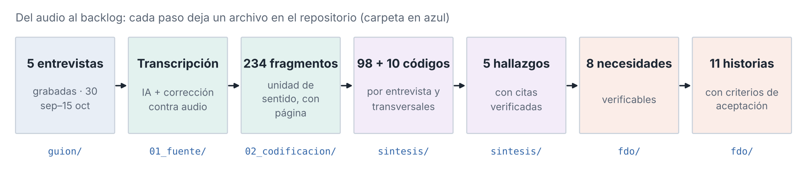

# Carto-Visor · Evidencia 1: lo que escuchamos antes de construir

**Autor:** Emilio Gómez Montuy (A01658834) · Gobierno y Transformación Pública
**Curso:** Diseño e implementación de innovaciones públicas, Gpo. 501 · Tecnológico de Monterrey, campus Ciudad de México · ago–dic 2026
**Socio formador:** Agencia Digital de Innovación Pública (ADIP) de la Ciudad de México · reto Carto-Visor
**Versión:** 1.1.0 (anonimizada) · **Cómo citar:** [`CITATION.cff`](CITATION.cff)

La ADIP quiere una biblioteca común de capas cartográficas porque, como dijo la directora del encargo, *"al hacer esos cruces pues nos salen a todos resultados diferentes"*. Antes de construirla entrevisté a cinco personas que producen, consumen o programan información territorial. Este repositorio guarda todo lo que salió de esas entrevistas, desde la transcripción hasta las historias de usuario que el equipo va a desarrollar, y permite comprobar cada afirmación del reporte.

> **La idea central:** el problema del Carto-Visor no es sólo juntar capas en un mapa. Es saber qué representa cada una, de cuándo es, quién la respalda y a quién preguntar cuando algo no cuadra. Sin eso, la gente vuelve a su copia conocida.



## Por dónde empezar

| Si eres… | Empieza aquí |
|---|---|
| **El profesor o quien evalúa** | El reporte en [`reporte/`](reporte/) y, para revisar evidencia, [`sintesis/citas.csv`](sintesis/citas.csv): cada cita del reporte con su página. Después, `python scripts/verificar_entrega.py`. |
| **El equipo de desarrollo** | [`fdo/historias_de_usuario.csv`](fdo/historias_de_usuario.csv): once historias con criterios de aceptación. Cada una enlaza la necesidad que atiende y la cita que la sostiene. El boceto del visor ideal está en [`reporte/figuras/fig6_visor_ideal.png`](reporte/figuras/fig6_visor_ideal.png). |
| **Quien retome el proyecto en una fase 2** | [`sintesis/README.md`](sintesis/README.md) para entender los hallazgos y [`fdo/README.md`](fdo/README.md) para usar los objetos digitales en el siguiente análisis. |
| **Quien quiera leer una entrevista** | [`entrevistas/`](entrevistas/): una carpeta por persona, cada una con un README que dice quién es (anonimizada), qué aportó y sus frases clave. |

## Las cinco entrevistas

| ID | Perfil | Tipo de actor | Fecha |
|---|---|---|---|
| E1 | La coordinadora del encargo (ADIP, sesión grupal) | Coordina y consume | 30 sep 2026 |
| E2 | El analista territorial | Consume para decidir | 2 oct 2026 |
| E3 | La usuaria administrativa | Consume sin ser especialista | 7 oct 2026 |
| E4 | El desarrollador | Construye la herramienta | 10 oct 2026 |
| E5 | El cartógrafo de alcaldía | Produce y actualiza el dato | 15 oct 2026 |

Las personas aparecen por su rol. Se retiraron nombres, apellidos y empleadores de transcripciones, análisis y metadatos.

## Qué hay en cada carpeta

| Carpeta | Contenido | Ref. en el reporte |
|---|---|---|
| [`guion/`](guion/) | Guion semiestructurado de siete bloques, con las preguntas que se hicieron. | A1 |
| [`entrevistas/`](entrevistas/) | Por entrevista: transcripción anonimizada, libro de códigos, corpus codificado, hallazgos, historias y análisis por fases. | A2, A3, A4 |
| [`sintesis/`](sintesis/) | La lectura conjunta: citas verificadas, códigos transversales, perfiles, procesos, actores y visor ideal. | A5 |
| [`fdo/`](fdo/) | Necesidades, historias de usuario, perfiles y citas como FAIR Digital Objects enlazados. | A6 |
| [`consentimiento/`](consentimiento/) | Dónde consta el consentimiento oral de cada persona. | A7 |
| [`ia/`](ia/) | Declaración de uso de IA, instrucciones por fase y registro de llamadas a LLM. | A8 |
| [`scripts/`](scripts/) | Verificación de integridad, citas y objetos FDO. | A9 |
| [`reporte/`](reporte/) | El reporte en PDF y sus seis figuras. | — |
| [`metadatos/`](metadatos/) | Metadatos DataCite, inventario con huellas SHA-256 y tabla de entrevistas. | — |
| [`consigna/`](consigna/) | Instrucciones y rúbrica del curso. | — |

## Comprobar que todo está en orden

```bash
python scripts/verificar_entrega.py
```

Verifica que ningún archivo cambió, que los cinco paquetes son válidos, que las citas aparecen literalmente en su página y que los objetos FDO cumplen su esquema y conservan su huella. Sólo usa la biblioteca estándar de Python 3.

## FAIR, en concreto

| Principio | Cómo se cumple aquí |
|---|---|
| **Localizable** | Cada necesidad, historia, perfil y cita tiene un identificador URN UUID estable ([`fdo/registro.json`](fdo/registro.json)); el conjunto tiene metadatos DataCite ([`metadatos/metadata.json`](metadatos/metadata.json)) y archivo de citación. Repositorio público e indexable. |
| **Accesible** | HTTPS y `git clone`, sin registro. Las transcripciones tienen uso académico restringido ([`LICENSE.md`](LICENSE.md)). |
| **Interoperable** | CSV UTF-8, JSON con esquemas ([`fdo/tipos/`](fdo/tipos/)), Markdown y PDF. Los objetos se enlazan con relaciones tipificadas (`satisface`, `evidenciadoPor`, `derivaDe`). |
| **Reutilizable** | Licencias por tipo de contenido, procedencia en cada objeto, declaración de IA y un script que reproduce la verificación. |

## Limitaciones
- El consentimiento fue oral y consta en cada transcripción; no hay cartas firmadas.
- No se entrevistó a la SSC, que produce las dos capas del prototipo. Es la siguiente entrevista prioritaria.
- Los audios no se publican para proteger a las personas entrevistadas.
- No hubo una segunda codificación independiente; las historias de usuario son propuestas por validar con la ADIP.
- Los PID son locales: estables, pero no resolubles en un servicio como Handle o DOI.
